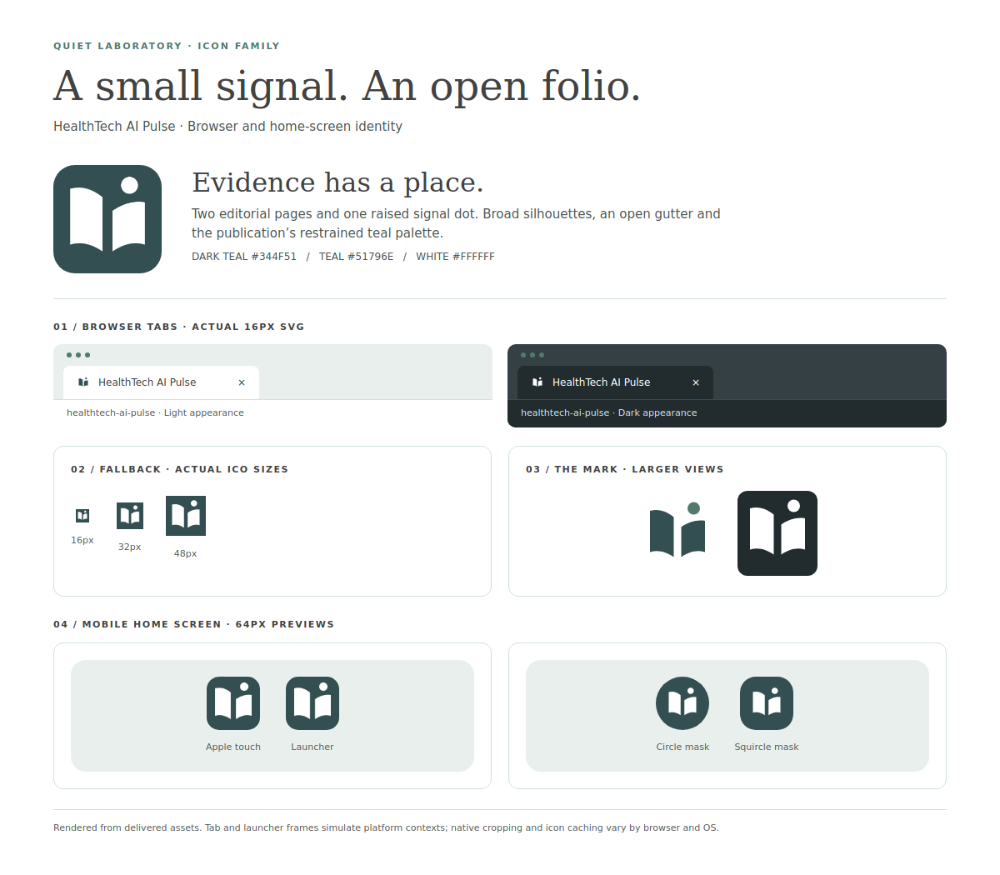

# Publication icons

The **open folio** combines two editorial pages and a raised signal dot. Its broad, filled shapes and open central gutter stay legible at 16px. It complements the serif masthead without squeezing initials into a browser tab. This is a publication identifier, not a clinical or certification symbol.

The transparent SVG uses dark teal `#344F51` and teal `#51796E` on light browser chrome, switching to white on dark chrome. Touch/app icons use white artwork on a solid dark teal square; the operating system supplies corner masks. These brand assets are separate from generated editorial photographs.

| Asset                                     | Use                                                  |
| ----------------------------------------- | ---------------------------------------------------- |
| `public/favicon.svg`                      | Editable master; adaptive light/dark browser favicon |
| `public/favicon.ico`                      | Opaque 16, 32 and 48px fallback frames               |
| `public/apple-touch-icon.png`             | Opaque 180px Apple home-screen icon                  |
| `public/icons/app-192.png`, `app-512.png` | Opaque 192/512px launcher icons                      |
| `public/icons/maskable-512.png`           | Separate 512px maskable icon with inset artwork      |
| `public/site.webmanifest`                 | Shared publication identity and icon declarations    |

After editing the SVG paths or circle, run `npm run icons:generate` and commit the generated assets. Sharp is pinned as a direct development dependency for reproducible rasterisation. The generator fixes raster colours explicitly instead of relying on an SVG renderer's media-query behaviour.

The shared `BaseLayout.astro` declares the icons for every page. The manifest keeps `display: browser`, consistent with the reading website; adding icons introduces no offline behaviour or service worker. Installation prompts and final cropping depend on the browser and OS. Favicons and existing home-screen shortcuts can remain cached; re-add a shortcut when checking a changed icon.

The maskable artwork is inside the central safe circle of radius 40% of the image width, with an opaque edge-to-edge background. See [MDN's icon guidance](https://developer.mozilla.org/en-US/docs/Web/Progressive_web_apps/How_to/Define_app_icons) and [Apple's touch-icon guidance](https://developer.apple.com/library/archive/documentation/AppleApplications/Reference/SafariWebContent/ConfiguringWebApplications/ConfiguringWebApplications.html).

The preview uses the delivered files. Browser-tab and home-screen frames are simulations, not captures of native browser chrome or physical devices.

## Verification

`npm run verify` passed on Node.js 24.19.0: lint, formatting, schema/content/editorial/illustration checks, 131 unit tests, Astro diagnostics and the production build. Headless Chromium loaded the built homepage, About, desk, story and dated-edition pages with shared metadata; all declared icon and manifest URLs returned successfully. Pixel samples confirmed dark teal and white SVG interiors in light/dark contexts at 16px. The PNGs have their declared dimensions and no alpha channel; the ICO contains 16/32/48px frames. The maskable image's furthest non-background pixel is 173.49px from its centre, within the 204.8px safe radius.

The model reviewed the rendered sheet for small-size clarity, contrast, balance and representative circle/squircle masks. Physical iOS/Android devices and native Safari/Windows icon selection were not tested.
