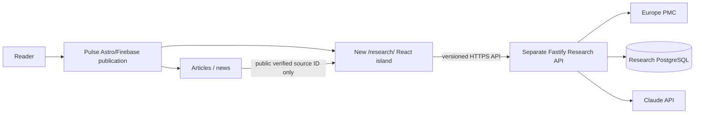

# HealthTech Scientific Evidence Intelligence — Hybrid Project Foundation

**Research design foundation v0.2 · Proposed for Pulse adoption on 2026-10-21 · Documentation only.**

> **One reader experience, two isolated technical domains.** HealthTech AI Pulse remains the public editorial site. A new `/research/` experience is planned inside it; a separate, independently deployed Research API performs scientific retrieval and AI synthesis. Research intelligence, **not medical advice** or clinical validation.

## Why the architecture changed

The earlier v0.1 kit assumed a **standalone React/Vite website** plus Fastify backend. This v0.2 revises that assumption to reuse the existing `GadDev/healthtech-ai-pulse` Astro 7 site, navigation, brand and audience **without creating a second frontend site**. The research backend still stays separate for credentials, user data, model costs and release independence. No automatic publication integration is allowed.

## Snapshot of actual existing foundation

Inspected `GadDev/healthtech-ai-pulse` `main` on 2026-10-21: Astro 7/TypeScript 6/Node 24 static site, Pagefind, Playwright, Firebase Hosting at `https://healthtech-ai-pulse.web.app/`. React integration, `/research/` route, research database, hosted research API and research accounts are **not implemented** as part of the inspected baseline. Recheck `main` before coding.

## MVP reader flows

1. From a Pulse article with an **already verified** DOI/PMID/PMCID or from navigation, open proposed `/research/`.
2. Discover and inspect Europe PMC scientific records and disclosure of source/date/coverage/access.
3. Select up to ten records and ask a bounded question across rights-permitted abstracts/excerpts.
4. View a Claude draft with verified evidence IDs, source passages, uncertainty and limitations; perform human review and export a research brief.
5. If the Research API is offline, news pages stay live; the research route explains the outage without implying a scientific conclusion.

## Architecture overview



## Document index

| Priority | Path                                                                    | Purpose                                                        |
| -------- | ----------------------------------------------------------------------- | -------------------------------------------------------------- |
| 1        | [Mission](strategy/MISSION.md)                                          | Audience, user journeys, hybrid product purpose                |
| 1        | [Constitution](strategy/CONSTITUTION.md)                                | Evidence, editorial/clinical separation, safety, release rules |
| 2        | [PRD-001 — Discovery](product/PRD-001-DISCOVERY.md)                     | Article → research, public literature search, selection        |
| 2        | [PRD-002 — Evidence workspace](product/PRD-002-EVIDENCE-WORKSPACE.md)   | Scoped citations, review and export                            |
| 1        | [Pulse integration contract](engineering/PULSE_INTEGRATION_CONTRACT.md) | Safe links, versioned HTTP, environments and failures          |
| 2        | [Architecture](engineering/ARCHITECTURE.md)                             | Service boundaries, diagrams, trust model                      |
| 2        | [Tech stack](engineering/TECHSTACK.md)                                  | Existing vs new stack, costs, auth, hosting options            |
| 2        | [Data/API contracts](engineering/DATA_AND_API_CONTRACTS.md)             | Draft schema, endpoints, authorization                         |
| 1        | [Decision log](engineering/DECISION_LOG.md)                             | Revised ADR hypotheses and open questions                      |
| 2        | [Scientific sources & rights](assurance/SOURCES_AND_RIGHTS.md)          | Citation provenance and licenses                               |
| 2        | [Evaluation](assurance/EVALUATION_PLAN.md)                              | Gold set, groundedness, injection, quality gates               |
| 2        | [Security & compliance](assurance/SECURITY_AND_COMPLIANCE.md)           | Privacy, auth, clinical boundaries, costs                      |
| 2        | [Roadmap](delivery/ROADMAP.md)                                          | M0–M5, 12-week plan and release gates                          |
| 2        | [Backlog](delivery/IMPLEMENTATION_BACKLOG.md)                           | Scoped Pulse and API issues and PR sequence                    |

## Authority, exclusions and verified source mapping

**Pulse remains the publication authority.** [Pulse constitution](../CONSTITUTION.md), [editorial policy](../EDITORIAL.md), [content model](../CONTENT_MODEL.md), [technical decisions](../TECHSTACK.md), [visual constitution](../editorial/VISUAL_CONSTITUTION_V1.md) and executable validators control journalism, story schemas, assets, release processes and publishing. These proposed research documents do not supersede them. In particular, the existing no-React/no-accounts technical baseline describes **editorial pages**; a narrowly scoped React island and eventually separately authenticated research workspaces are _proposed exceptions for `/research/` only_, not changes to articles.

Source check on `main` (2026-10-21): the strict story schema at `src/lib/editorial-schema.ts` has `candidateId` and public `sources` containing `id/label/url`, **not dedicated DOI/PMID/PMCID** fields. Candidate ledgers have nullable `underlying_identity.doi` and `.pmid`, but no dedicated PMCID. Article URLs use `/stories/${story.id}/`. Deep links are deferred until eligibility can be verified against published `story.id`, matching selected candidate, `publication.story_ids`, approved publication verification, and independently checked primary identifier; a `source.id` like `journal` is not a PMID. See [public-ID contract](engineering/PULSE_INTEGRATION_CONTRACT.md).

The source design kit also contains optional post-MVP monitoring, business validation and a chat handoff. Those three files are intentionally **not adopted into Pulse**. Their absence is not an MVP blocker. No backend repository, API, authentication, credentials, or live `/research/` route is created.

## Implementation sequence (not yet executed)

1. **PR 1 — this documentation foundation:** no runtime change.
2. **PR 2 — fixture-only `/research/`:** add `@astrojs/react` after dependency compatibility review, one scoped island and accessible offline/empty/invalid states; default all PR previews to static fixtures and prove existing news, RSS, Pagefind and sitemap work when API is unavailable.
3. **Later reviewed PRs:** verified article identifiers and a pinned, versioned API client.
4. **Separate API repo:** requires explicit authorization and independent cost, region, auth, rights, deployment and security decisions.

## Initial code targets (not created)

```text
GadDev/healthtech-ai-pulse            # existing (extend Astro only where needed)
  src/pages/research/index.astro      # proposed
  src/components/research/*           # proposed React island
  src/lib/research/*                  # proposed typed API client + fixtures

GadDev/healthtech-evidence-api        # proposed separate backend repo
  src/modules/{sources,catalog,workspace,evidence,ai}/
  src/routes/v1/
  migrations/
  eval/
```

## Delivery starting point

**M0 / Week 1:** inspect current Pulse story and routing schemas, approve hybrid docs and the public source-ID link rule, then create a **draft docs PR in Pulse** only when explicitly asked. **M1:** `/research/` fixture React island that does not depend on Research API deployment. API implementation is later; no paid model/cloud resource is required to begin.

## External references / boundaries

- Pulse: https://github.com/GadDev/healthtech-ai-pulse
- Existing site: https://healthtech-ai-pulse.web.app/
- Europe PMC: https://europepmc.org/RestfulWebService
- Astro React: https://docs.astro.build/en/guides/integrations-guide/react/
- Firebase hosting configuration: https://firebase.google.com/docs/hosting/full-config
- Claude structured outputs: https://platform.claude.com/docs/en/build-with-claude/structured-outputs

## Status and truthfulness

This PR adopts **documentation only**. It does not create repositories, implement the `/research/` route, configure any authentication, provision a Cloud Run service, make API calls, perform tests, change editorial PRs, or deploy a new product. All milestones and pricing/privacy decisions remain subject to review.
