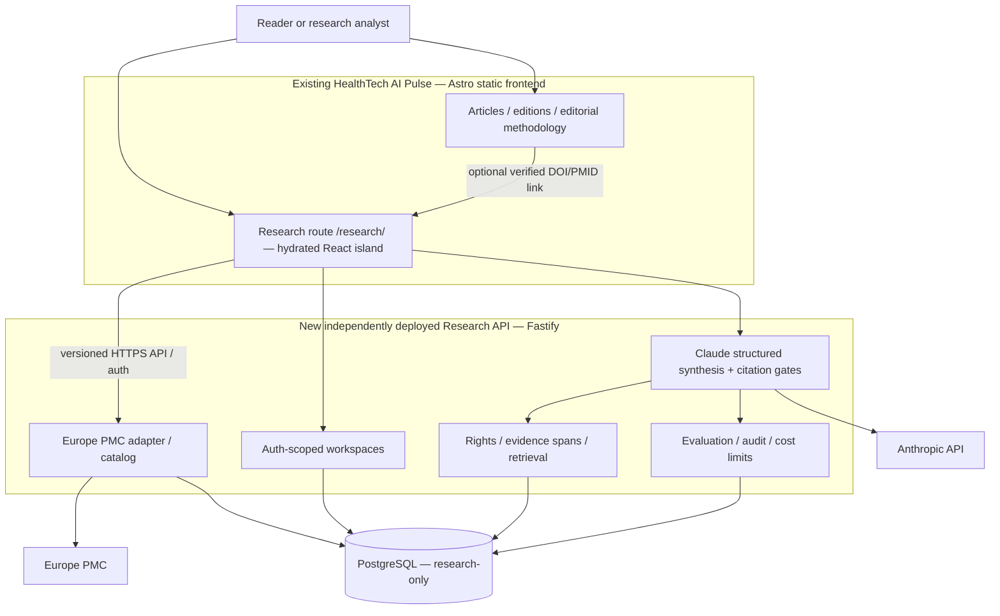

# Architecture — One Experience, Two Independently Operated Services

> **Adoption status (Pulse PR 1): PROPOSED — documentation only.** No research route, API, repository, database, authentication provider, hosted workspace or model deployment is established by this document. The existing Pulse editorial policy and executable contracts remain authoritative for journalism and releases.

**Status:** Proposed hybrid v0.2. Static publication already exists; all research features remain to be implemented.

## System context


## Repository and deployment independence
1. **Pulse repository** remains the only reader-facing website. Feature adds a route and React island under `src/pages/research/`; Astro builds it statically and Firebase serves it with existing news routes. Its regular CI and deployment must continue with the Research API shut down.
2. **Research API repository** is proposed separately for model credentials, datastore migrations, access controls, AI evaluations, runtime observability, scaling and independent API releases. No editorial pipeline dependencies or write access to Pulse source.
3. Research frontend releases consume a **pinned compatible API v1 contract**. Server can be upgraded without rewriting Pulse articles; frontend may deploy even when backend is offline with graceful degradation. Any incompatible API change is staged and verified before retiring old versions.
4. Public links between systems are read-only identifiers/topic links. Private workspaces live only in API DB and authenticated UI state, never in canonical article files or search indexes.

## Deep-link and user flows
```mermaid
flowchart LR
  Article[Read Pulse article] -->|verified public DOI/PMID| Research[/research/ static page]
  Nav[Pulse nav] --> Research
  Research -->|search request| API[Research API]
  API -->|source coverage + records| Research
  Research -->|selected papers + question| API
  API -->|claims with valid evidence IDs or abstention| Research
  Research -->|human review| Export[Research brief export]
```

## API retrieval and synthesis sequence
```mermaid
sequenceDiagram
  participant B as Browser React island
  participant A as Research API
  participant P as Europe PMC
  participant D as Research DB
  participant C as Claude API
  B->>A: Search query (bounded, request ID)
  A->>P: Search + metadata
  P-->>A: Records or typed source failure
  A->>D: Normalize metadata / source provenance
  A-->>B: Results + coverage/partial errors
  B->>A: Authenticated selected papers + question
  A->>D: Authorize owner; rights gate; select spans
  A->>A: Lexical retrieval and bounded context
  A->>C: Structured synthesis with allowed span IDs
  C-->>A: Proposed claims and citations
  A->>A: Schema / corpus / evidence ID / budget gate
  A->>D: Record run and draft or abstention
  A-->>B: Draft claims + linked spans + limitations
  B->>A: Explicit reviewer action / export
```

## Modules and trust boundaries
- `source-adapters`: fixed allowlisted upstream APIs, throttling and source response normalization; no arbitrary user URL fetching.
- `catalog`: DOI/PMID/PMCID identity, aliases, snapshot versions and correction status.
- `rights`: no full-text persistence without permission; abstracts only as permitted.
- `workspace`: authenticated owner checks, research-set bounds, question and review states.
- `retrieval`: in-scope evidence spans and lexical relevance; no model-remembered citation as primary proof.
- `ai`: model configuration, cost guard, structured output parsing, citation verifier, explicit abstention.
- `audit`: trace and incident fields excluding credentials and inappropriate raw personal text.
- **Untrusted data:** source abstracts and model outputs must not be treated as instructions. The UI must escape/sanitize source content.

## Auth and network decision points
- MVP local fixture flow can run without credentials; hosted persistent workspaces and paid synthesis require authenticated users and server-side authorization.
- Browser-to-API strategy starts with an explicitly configured HTTPS origin and restricted CORS allowlist. Review auth-token storage, origin list and leak risks. Never rely on CORS as authorization.
- A same-origin Firebase Hosting rewrite to Cloud Run is an **optional post-spike ADR**, not current architecture. Cloud Run billing and request timeouts must be assessed. Heavy operations may need async job APIs rather than long HTTP requests.
- Avoid API requests during Astro static builds, RSS, Pagefind indexing and editorial article validation.

## Failure containment and operational gates
- Research backend down → `/research/` shows unavailable/readonly guidance; article/news/edition pages load normally.
- Europe PMC 429/error → recoverable source error; do not say zero scientific findings.
- Claude timeout/invalid evidence → draft stays failed/unverified; no fabricated citation.
- Database/outage → protected actions disabled; no private cached states exposed to another user.
- Cost cap → fail closed on model calls; publication keeps working.
- Deployment: independent PR checks, preview isolation, scoped OIDC/service identities, independent rollback and incident procedures.

## Evolution only after evidence
Better retrieval (hybrid/pgvector), monitoring, separate managed queues, cross-product public topic cards or editorial-source suggestions require measurements, rights review and separate ADRs. Never collapse editorial review into an autonomous research workflow.
